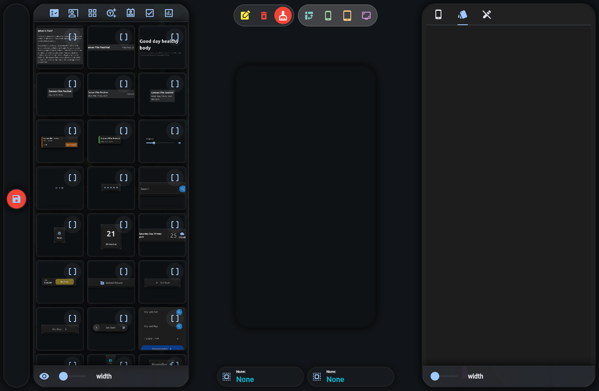

# FletBoxWeb

> Constructor visual de interfaces para [Flet](https://flet.dev), hecho con Flet.
> Selecciona widgets del catálogo, edita sus propiedades y exporta el código Python resultante.



## ¿Qué es?

FletBoxWeb es una herramienta para armar interfaces de Flet sin escribirlas a mano. Tiene un catálogo de widgets, un lienzo con forma de teléfono donde se agregan los controles y un panel lateral para editar sus atributos. Al final genera el código Python del diseño y lo muestra en un editor con resaltado de sintaxis.

Aunque los módulos se llaman `dragg_*` / `dropp_*`, la interacción actual es **clic para agregar** un widget al contenedor seleccionado (no drag & drop nativo de Flet).

## Funcionalidades

- **Catálogo por categorías** (`src/dragg_widgets/dragg_container.py`): Customs, Custom Cards, Layouts, Buttons, Cupertino, Selection y Charts.
- **Librerías de widgets**: bloques compuestos, tarjetas/banners, controles nativos de Flet (layouts, botones, tabs, sliders, grids, tablas, gráficos) e iconos.
- **Lienzo con presets de dispositivo**: Teléfono (320×600), Tablet (420×720) y PC (1240×720), con botones de Editar, Eliminar, Limpiar y Rotar.
- **Editor dinámico de atributos**: inspecciona el widget seleccionado y genera editores para booleanos, texto, números, alineación, colores, gradientes y márgenes/padding.
- **Vista de código fuente**: el icono `data_array_rounded` en cada widget del catálogo abre un overlay Markdown con su código.
- **Exportación**: serializa el árbol de widgets, lo formatea con `isort` + `autopep8` y lo muestra en un overlay con botón de copiar.
- **Tema oscuro** por defecto.

El estado de selección se guarda en `page.session` (`save_data`, `selected_in_phone_widget`, `validate_click_selection_widget`, `tabs_containers`).

## Requisitos

- Python 3.9+ (CI usa 3.12)
- [Flet 0.27.6](https://flet.dev)
- `fastapi<0.100` — obligatorio para `flet run --web`: FastAPI ≥0.100 eliminó `openapi_prefix`, que usa el servidor web de Flet 0.27.6
- `autopep8`, `isort`
- Flutter 3.24.0 solo si quieres hacer un build web local (`flet build web`)

## Instalación

```bash
git clone https://github.com/kuko53348/FletBoxWeb.git
cd FletBoxWeb
python3 -m venv .venv
source .venv/bin/activate          # Windows: .venv\Scripts\activate
python -m pip install --upgrade pip
pip install -r requirements.txt
```

## Ejecutar

```bash
flet run src/main.py               # ventana de escritorio
flet run -w src/main.py            # navegador / modo web
```

> **Importante:** usa siempre el `flet` del entorno virtual. Si tu sistema tiene otro Flet instalado globalmente (por ejemplo 0.86.x), el comando `flet` puede resolver al global y fallar con errores de API. Verifica con `which flet` — debe apuntar a `.venv/bin/flet`. Si el shell tiene el comando en caché, corre `hash -r` después de activar el venv.
>
> `python -m flet` **no funciona** con Flet 0.27.6 (`No module named flet.__main__`); usa el script `flet` directamente.

### Build web local

```bash
flet build web --base-url FletBoxWeb --route-url-strategy hash
```

`[tool.flet.app] path = "src"` en `pyproject.toml` permite que `flet build web` encuentre la app sin pasar la ruta del script.

## Deploy web (GitHub Pages)

El workflow [`.github/workflows/deploy-web.yml`](.github/workflows/deploy-web.yml) compila la app y publica `build/web` en GitHub Pages en cada push a `main`/`master`.

1. Ve a **Settings → Pages → Build and deployment → Source** y selecciona **GitHub Actions**.
2. Haz push a `main`. El workflow instala dependencias, corre `flet build web --base-url ${GITHUB_REPOSITORY#*/} --route-url-strategy hash`, sube el artefacto y lo despliega con `actions/deploy-pages@v4`.

La URL esperada es `https://kuko53348.github.io/FletBoxWeb/`.

`--route-url-strategy hash` mantiene las rutas como `#/home`, lo cual funciona en GitHub Pages sin configurar un fallback SPA en el servidor.

> **Nota:** existe un segundo workflow, `.github/workflows/build-apk-ipa-mobile.yml`, que en realidad también hace build + deploy web (no genera APK/IPA). Ambos comparten el grupo de concurrencia `pages`, así que un push a `main` dispara dos despliegues; el último gana. Puedes deshabilitar uno si quieres un solo deploy por push.

## Estructura del proyecto

```
src/
├── main.py                            # entrypoint: tema, ventana y rutas (/ y /home)
├── flet_box_app/                      # compone el escritorio de 4 paneles
├── left_lite_menu/                    # botón de guardar/exportar; serializa y formatea
├── dragg_widgets/                     # catálogo, librerías de widgets y plantillas
├── dropp_widgets/                     # lienzo, selección y toolbar (Edit/Delete/Clean/Rotate)
├── dragg_dropp_edit_attr_widgets/     # editores de atributos y filtros de entrada
├── black_formated_data/               # serialización y CodeFormatter (isort + autopep8)
├── markdown_code_editor/              # visor/editor del código generado
├── assets/                            # imágenes y miniaturas del catálogo
├── utils_safe_print.py                # print() a prueba de BrokenPipeError
└── ui_refactoy_code.py                # destino del código generado (ignorado por git)
docs/
└── web-screenshot.png                 # captura de la versión web
.github/workflows/deploy-web.yml       # CI/CD a GitHub Pages
requirements.txt / pyproject.toml
```

## Notas

- El proyecto está fijado a **Flet 0.27.6**. Migrar a Flet 1.x requiere refactorizar APIs cambiadas (`Tabs`, `Chart*`, `Button.text`, `padding`/`margin`, `Icons`, etc.). En esta versión los gráficos de ejemplo (barra, línea, pastel) sí están disponibles en `src/dragg_widgets/flet_widgets.py`.
- Los `print()` de debug dentro de los handlers se reemplazaron por `safe_print()` para evitar `BrokenPipeError` cuando el output está pipeado o el terminal se cierra.
- El código generado se escribe con la ruta relativa `./src/ui_refactoy_code.py`. Bajo `flet run` el directorio de trabajo puede ser `storage/data`, así que el archivo podría caer en `.flet/storage/data/src/`. Trata el código exportado como un punto de partida: puede necesitar limpieza manual.
- No hay archivo `LICENSE` en el repositorio.
